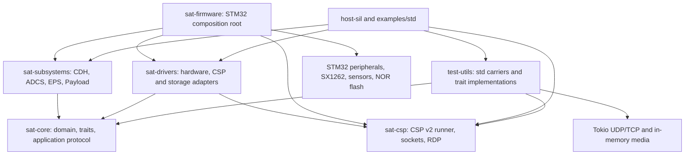
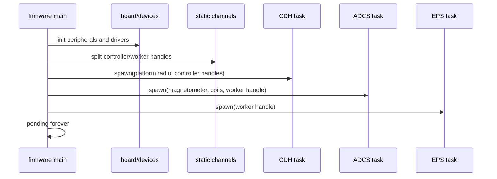
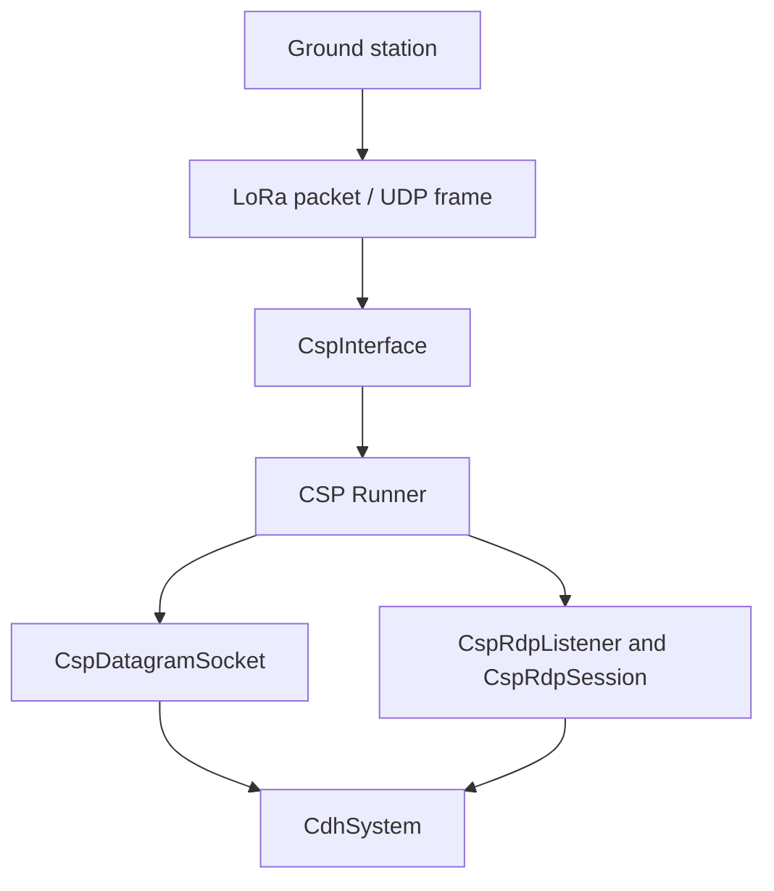
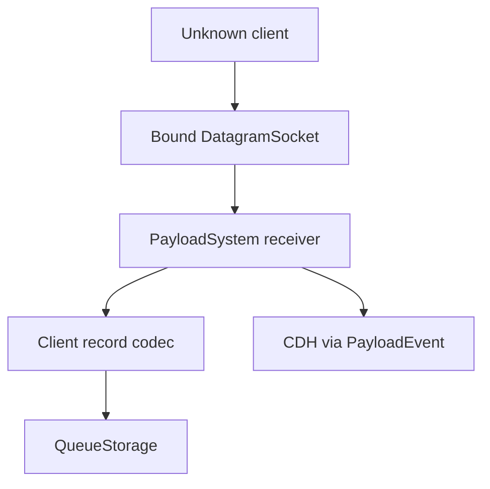
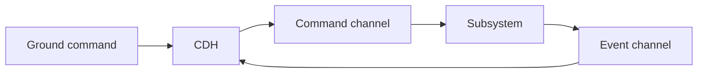

# Архитектура `sat-fsw`

> Срез текущего состояния проекта на 2026-11-17. Документ предназначен как контекст для разработчиков и AI-ассистентов. Код остаётся окончательным источником истины. Разделы «Архитектурное ядро» описывают решения, замена которых затронет много crates и должна считаться отдельной миграцией. Разделы «Текущая реализация» фиксируют код, который ещё может развиваться локально.

## 1. Назначение проекта

`sat-fsw` — Rust workspace для бортового ПО спутника и связанных host-инструментов.

Основные цели:

- работа flight-кода в `no_std` на STM32 с Embassy;
- разделение прикладной логики подсистем и конкретного железа;
- статически выделенная память и bounded queues в embedded runtime;
- CSP v2 как бортовой сетевой стек;
- LoRa SX1262 как физический носитель CSP;
- подмена сети, storage и периферии в host-тестах и SIL;
- единая прикладная логика для firmware и std simulation;
- отсутствие обязательного allocator в flight-path.

Планируемые и частично реализованные подсистемы:

- **CDH** — центральная логика команд, телеметрии, межподсистемной координации и связи с наземной станцией;
- **ADCS** — измерение ориентации и управление магнитными катушками;
- **EPS** — питание, заряд и режимы энергопотребления;
- **Payload/Service** — абонентский сервис: маяки, приём клиентских датаграмм, сохранение и последующая выгрузка.

## 2. Уровни стабильности решений

### 2.1. Архитектурное ядро: менять только осознанной миграцией

Следующие решения пронизывают несколько crates:

1. **Cargo workspace из отдельных crates по слоям.**
2. **`no_std` для core, protocol stack, drivers и subsystem logic.**
3. **Embassy async model** в firmware и общем subsystem-коде.
4. **Статическая и bounded память**: const generics, `heapless`, Embassy channels, caller-owned buffers.
5. **Dependency inversion через traits `sat-core`.** Подсистема получает готовые handles; она не создаёт HAL, socket, flash или executor.
6. **Composition root вне подсистем.** `firmware` или host binary создаёт устройства, channels, protocol resources, sockets и storage, затем передаёт ownership задачам.
7. **Message-oriented communication.** Прикладные `DatagramSocket` и `ReliableSession` сохраняют границы сообщений; это не byte streams.
8. **Два сетевых уровня абстракции:**
   - `sat_csp::CspInterface` между CSP stack и packet carrier;
   - `sat_core::net::*` между subsystem logic и transport implementation.
9. **CSP adapter находится в `sat-drivers`.** Подсистемы не зависят от типов `sat-csp`.
10. **Команды и события подсистем передаются bounded Embassy channels.** CDH получает controller side, subsystem получает worker side.
11. **Wire types приложения находятся в `sat_core::protocol` и используют `postcard`.** CSP header/RDP wire format остаётся внутри `sat-csp`.
12. **Storage представлен capability traits `QueueStorage` и `MapStorage`.** Реализации могут быть RAM или NOR flash.
13. **Firmware и host используют одну subsystem logic через разные adapters.**

### 2.2. Устоявшиеся, но локально заменяемые решения

- конкретная глубина channels и сетевых queues;
- размеры MTU и scratch buffers;
- конкретные номера CSP ports и node addresses;
- `postcard` как текущий application codec;
- Tokio для host/SIL;
- `sequential-storage` для NOR flash partitions;
- текущая модель `ControllerHandle`/`WorkerHandle` с одной command queue и одной event queue;
- `defmt-or-log` как logging facade.

### 2.3. Черновики и незавершённые части

- фактическая command orchestration в CDH;
- EPS domain model и hardware integration;
- подключение Payload в firmware;
- flash storage в production composition root;
- управление катушками на текущей плате;
- lifecycle и расширенные возможности RDP;
- `client-device`, `ground-station`, часть `examples/std` и satellite side `host-sil`;
- текущий root `README.md`, оставшийся от embedded template.

## 3. Общая схема слоёв



Желаемое направление зависимостей:

```text
application binaries
    depend on subsystems + drivers + protocol stack + platform runtime

subsystems
    depend on sat-core contracts

drivers
    implement sat-core contracts and adapt sat-csp

sat-csp
    depends only on packet carrier contract and Embassy synchronization

sat-core
    contains no HAL, board, Tokio or concrete transport
```

Текущее исключение: `sat-subsystems` зависит от `sat-drivers`, но использование найдено только в `subsystems/src/payload/tests.rs` для `RamStorage`. Это test-only coupling; архитектурно dependency должна быть dev-only.

## 4. Workspace и crates

Корневой `Cargo.toml` включает:

- `core` — crate `sat-core`;
- `csp` — crate `sat-csp`;
- `drivers` — crate `sat-drivers`;
- `subsystems` — crate `sat-subsystems`;
- `firmware` — crate `sat-firmware`;
- `client-device` — отдельная embedded application;
- `ground-station` — старое ground приложение;
- `host-sil` — актуальная host simulation/integration composition;
- `test-utils` — reusable mocks/fakes/adapters;
- `examples/*` — std и embedded examples;
- `vendor/mmc5983_rs` — локальный patch crate.

Workspace profiles оптимизированы под embedded size:

- `opt-level = "s"` для dev/release;
- `codegen-units = 1`;
- release использует `lto = "fat"`;
- release сохраняет debug symbols.

## 5. Composition root и ownership

### 5.1. Основной принцип

Подсистема не должна:

- инициализировать board peripherals;
- bind-ить CSP ports;
- создавать global channels;
- выбирать RAM или flash storage;
- выбирать Tokio или Embassy executor;
- решать, какое радио делится между сервисами.

Это делает composition root:

- `firmware/src/app.rs` и `firmware/src/tasks/*` на MCU;
- `host-sil/src/bin/*` или std test на host.

Подсистема получает concrete capabilities через constructor generics:

```rust
CdhSystem::new(
    config,
    controller_handles,
    beacon_socket,
    ground_listener,
    platform_storage,
    iot_storage,
)
```

Ownership перемещается в subsystem/task. Shared mutable hardware не прячется внутри подсистемы. Если один ресурс нужен нескольким задачам, coordination должна быть создана composition root через owner task, channel или явно выбранный mutex.

### 5.2. Firmware startup

Текущий порядок в `firmware/src/app.rs`:

1. `board::init()` создаёт и делит STM32 peripherals.
2. Инициализируются platform и service SX1262.
3. Инициализируется MMC5983MA.
4. `channels::split()` выдаёт controller и worker handles.
5. Не подключённые ресурсы удерживаются в `_reserved`.
6. Embassy spawner запускает CDH, ADCS и EPS tasks.
7. Root future остаётся жить через `pending::<()>()`.



### 5.3. Static resources

Channels объявлены `static` в `firmware/src/channels.rs`:

- `ADCS_COMMANDS`, `ADCS_EVENTS`;
- `EPS_COMMANDS`, `EPS_EVENTS`;
- `SERVICE_COMMANDS`, `SERVICE_EVENTS`.

Все используют:

- `embassy_sync::channel::Channel`;
- `CriticalSectionRawMutex`;
- command/event depth `4`;
- `'static` handles без `Box::leak`.

CSP resources сейчас создаются локально внутри долгоживущей CDH task:

```rust
ProtocolStackResources {
    stack: StackResources<...>,
    rdp: RdpResources<...>,
}
```

Они живут столько же, сколько task future, и заимствуются runner/socket/listener handles.

## 6. `sat-core`: контракты и общие типы

`core/src/lib.rs` экспортирует:

- `adcs`;
- `domain`;
- `eps`;
- `net`;
- `protocol`;
- `storage`;
- `time`.

Crate использует `#![cfg_attr(not(test), no_std)]`.

### 6.1. Network types

#### `Address`

`core/src/net/address.rs`:

```rust
#[repr(transparent)]
pub struct Address(u16);
```

Инварианты:

- CSP v2-compatible 14-bit range `0..=0x3FFF`;
- `Address::BROADCAST == 0x3FFF`;
- `Address::new` допускает broadcast;
- `Address::new_unicast` исключает broadcast;
- внутреннее значение закрыто, чтение через `get()`.

Важно: derived `Deserialize` не вызывает `Address::new`. При deserialization внешнего недоверенного значения validation надо учитывать отдельно.

#### `Endpoint`

`core/src/net/endpoint.rs` объединяет `Address` и `u8` port.

```rust
Endpoint::new(address, port)
Endpoint::broadcast(port)
```

`Endpoint` transport-neutral. Он допускает весь `u8`; CSP adapter отдельно проверяет `port <= 63`.

### 6.2. `DatagramSocket`

`core/src/net/datagram.rs` задаёт connectionless message transport:

```rust
pub trait DatagramSocket {
    type Error: Debug;

    async fn send_to(
        &mut self,
        destination: Endpoint,
        payload: &[u8],
    ) -> Result<(), Self::Error>;

    async fn recv_from(
        &mut self,
        buffer: &mut [u8],
    ) -> Result<DatagramMetadata, Self::Error>;

    fn discard_oversized(
        &mut self,
        capacity: usize,
    ) -> Option<DatagramMetadata>;
}
```

Обязательная семантика:

- один вызов — одна полная датаграмма;
- границы сообщений сохраняются;
- source возвращается через `DatagramMetadata`;
- молчаливое truncation запрещено;
- `send_to` подтверждает local acceptance, не remote delivery;
- pending `recv_from` должен быть cancellation-safe;
- oversized implementation может удержать сообщение для повторного чтения или явного `discard_oversized`.

Под этот trait подходят CSP datagrams, UDP и in-memory queues. Название намеренно не привязано к UDP.

### 6.3. Reliable sessions

`core/src/net/session.rs`:

- `ReliableSession` — established, message-oriented session;
- `SessionListener` — server-side `accept`;
- `SessionConnector` — client-side `connect`.

Ключевые свойства:

- это не TCP byte stream API;
- каждый `send`/`recv` соответствует одному сообщению;
- oversized message не должен обрезаться;
- `recv` и `accept` должны быть cancellation-safe;
- transport ACK не означает исполнение application command.

Текущие implementations:

- CSP RDP через `sat-drivers`;
- framed TCP mock через `test-utils`.

### 6.4. Storage contracts

#### `QueueStorage`

`core/src/storage/queue.rs` задаёт FIFO record storage:

- `append(entry)`;
- `peek(buffer)` без удаления;
- `pop()`;
- `clear()`;
- `max_entry_size()` capability;
- `error_kind()` для transport-neutral классификации ошибок.

`QueueErrorKind`:

- `Full`;
- `EntryTooLong`;
- `BufferTooSmall`;
- `CorruptEntry`;
- `Media`;
- `Other`.

Надёжный consumer pattern:

```text
peek record
process or transmit record
receive application-level acknowledgement
pop record only after success
```

Так cancellation или transport failure не удаляет запись.

#### `MapStorage`

`core/src/storage/map.rs` задаёт key/value storage для settings/configuration:

- `store`;
- `load`;
- `remove`.

### 6.5. Hardware traits

`sat-core::adcs` содержит async traits:

- `Mag`;
- `Imu`;
- `SunSensor`;
- `Coils`.

Subsystem logic зависит от этих traits, concrete drivers находятся в `sat-drivers`.

`core/src/time.rs` задаёт:

- `Clock::now_micros()`;
- `Delay::delay(core::time::Duration)`.

Это позволяет тестировать time-dependent subsystem logic без привязки к Embassy clock.

### 6.6. Domain и protocol

`core/src/domain/record.rs` содержит borrowed domain view:

```rust
ClientRecord<'a> {
    source: Endpoint,
    received_at_ms: u64,
    payload: &'a [u8],
}
```

`core/src/protocol` содержит application wire types:

- `Beacon`;
- `GroundCommand`;
- `GroundCommandResponse`.

Каждый тип имеет `encode`/`decode` через `postcard` и caller-provided buffer. Это не CSP wire format. CSP только переносит application payload.

Текущие команды:

- `RequestSatTelemetry`;
- `RequestClientData`;
- `ChangeBeaconInterval(u32)`;
- `SetTime(u64)`;
- `Ping`.

Ответы:

- `Received`;
- `Executed`;
- `Failed`.

Фактическая совместимость сейчас закреплена round-trip tests, но не version byte или golden application vectors. Изменение порядка enum variants или полей structs меняет postcard wire format и должно считаться protocol migration.

## 7. `sat-csp`: сетевой стек

`sat-csp` — независимый `no_std`, `unsafe`-free CSP v2 stack. Он не зависит от `sat-core`.

### 7.1. Граница с carrier

`CspInterface` в `csp/src/interface.rs`:

```rust
pub trait CspInterface {
    type Error;

    async fn send(&mut self, frame: &[u8]) -> Result<(), Self::Error>;
    async fn receive(&mut self, frame: &mut [u8]) -> Result<usize, Self::Error>;
}
```

Контракт:

- один `send` — один полный CSP frame;
- один `receive` — один полный CSP frame;
- framing, radio packetization, carrier CRC и recovery находятся ниже;
- `receive` должен быть cancellation-safe, потому что `Runner` использует `select` между RX/TX/RDP work;
- interface error останавливает runner; hidden retry нет.

Concrete implementations:

- `sat_drivers::lora::RadioSx1262` на MCU;
- `test_utils::host::UdpCspInterface` на host;
- `IdealBroadcastInterface` для in-memory simulation.

### 7.2. CSP wire format

Header фиксирован: 6 bytes, big-endian, CSP v2:

```text
priority:          2 bits
destination node: 14 bits
source node:      14 bits
destination port: 6 bits
source port:       6 bits
flags:             6 bits
```

Ограничения:

- node ID `0..=0x3FFF`;
- port `0..=63`;
- `MTU` включает 6-byte header;
- `Packet<255>` имеет максимум 249 bytes datagram payload;
- packet boundaries предоставляет `CspInterface`;
- HMAC, CRC32 и fragmentation flags объявлены, но не реализованы;
- поддержаны обычные datagrams и RDP flag.

Header codec проверяется libcsp-compatible golden vectors в `csp/tests/header_vectors.rs`.

### 7.3. Static stack resources

`StackResources<MTU, TX_DEPTH, SOCKETS, RX_DEPTH>` владеет:

- одной bounded TX queue;
- compile-time числом socket RX queues;
- фиксированной глубиной каждой RX queue.

`RunnerBuilder`:

1. принимает local node address, concrete `CspInterface` и borrow ресурсов;
2. bind-ит datagram ports;
3. опционально создаёт RDP client или listener;
4. `build()` фиксирует routing table и возвращает `Runner`.

Выданные `Socket`, `RdpListener`, `RdpClient` и `Runner` заимствуют application-owned resources. Это причина явных lifetimes и долгоживущих/static resource structs.

### 7.4. Datagram behavior

`sat_csp::Socket`:

- `send_to` ждёт место в local TX queue;
- успешный return не подтверждает эфир или delivery;
- `recv_from` возвращает owned `Datagram<MTU>`;
- reliability, retry и deduplication отсутствуют;
- broadcast использует node `0x3FFF`;
- при полной destination RX queue новый packet отбрасывается.

### 7.5. Runner

`Runner::run` обслуживает:

- carrier RX;
- datagram TX queue;
- RDP commands;
- RDP clock updates.

Routing policy:

- malformed frame — drop и `decode_errors`;
- чужой destination — drop;
- unbound port — drop;
- full RX queue — drop newest;
- interface send/receive error — завершение runner.

`RunnerStats` содержит counters transmitted/received/decode/wrong destination/no socket/full queue/RDP errors.

### 7.6. RDP profile

Текущая RDP реализация — ограниченный reliable message profile:

- одно соединение на runner;
- window size `1`;
- handshake SYN/SYN-ACK/ACK;
- cumulative ACK;
- timeout и retransmission;
- duplicate DATA не доставляется приложению повторно;
- несколько последовательных сообщений внутри открытого connection поддержаны;
- RDP time приходит извне через `RdpResources::update_time(u32)`.

Не поддержаны:

- несколько одновременных connections;
- close/reopen lifecycle;
- EAK и out-of-order buffering;
- window больше `1`;
- delayed ACK;
- fragmentation длинного application payload;
- cleanup отменённого `connect`/`send` как законченный public contract.

Для MTU `255` максимальный RDP application payload сейчас 244 bytes:

```text
255 - 6 byte CSP header - 5 byte RDP trailer
```

## 8. `sat-drivers`: adapters и hardware

`sat-drivers` — `no_std` crate с concrete implementations. Основные модули:

- `bmi088`;
- `mmc5983ma`;
- `veml6030`;
- `coils`;
- `lora`;
- `csp`;
- `flash`;
- `storage`.

`uart` существует, но не экспортируется; он использует удалённый legacy `PhyLayer` API.

### 8.1. Sensors и actuators

- `ImuBmi088` реализует `sat_core::adcs::Imu`.
- `MagMmc5983` реализует `sat_core::adcs::Mag`.
- `SunSensorImpl` реализует `sat_core::adcs::SunSensor` и нормализует lux относительно `100_000`.
- `CoilsImpl` реализует `sat_core::adcs::Coils` поверх двух DRV8833.

Текущее ограничение: `CoilsImpl::get_current` содержит `todo!()`.

### 8.2. SX1262 carrier

`drivers/src/lora/sx1262.rs` содержит `RadioSx1262`, который реализует `sat_csp::CspInterface`.

Текущие параметры зашиты в implementation:

- SF12;
- bandwidth 125 kHz;
- coding rate 4/5;
- continuous RX;
- max LoRa payload 255;
- TX power 20;
- TCXO 1.8 V;
- DCDC и RX boost включены.

Один LoRa packet переносит один полный CSP frame. Подтверждённой hardware-level cancellation recovery пока нет; это критично, потому что CSP runner может отменять pending `receive`.

### 8.3. CSP adapters к `sat-core::net`

`drivers/src/csp/socket.rs`:

```text
sat_csp::Socket
    adapted as
sat_core::net::DatagramSocket
```

`CspDatagramSocket`:

- валидирует CSP node/port;
- копирует payload в caller buffer;
- преобразует source в `Endpoint`;
- удерживает oversized `Datagram` в `pending`;
- позволяет explicit discard через `discard_oversized`.

`drivers/src/csp/session.rs`:

```text
sat_csp::RdpConnection
    adapted as
sat_core::net::ReliableSession

sat_csp::RdpListener
    adapted as
sat_core::net::SessionListener
```

`CspRdpSession` также удерживает oversized message в `pending`.

Ground-side `SessionConnector` adapter в `sat-drivers` пока отсутствует; host ground code использует `RdpClient` напрямую.

### 8.4. Flash и storage

#### Async W25Q64

`AsyncW25Q64` реализует standard traits:

- `embedded_storage_async::nor_flash::ReadNorFlash`;
- `NorFlash`;
- `MultiwriteNorFlash`.

Параметры:

- 8 MiB;
- page 256 bytes;
- erase sector 4096 bytes;
- accepted JEDEC IDs для W25Q64 variants.

Write делится по page boundaries. Busy polling async и bounded timeout. SPI errors сохраняются.

#### `SequentialQueue`

`drivers/src/storage/queue.rs` адаптирует `sequential-storage` к `sat_core::storage::QueueStorage`.

Свойства:

- FIFO;
- no overwrite для generic queue adapter;
- non-destructive `peek`;
- ошибки переводятся в `QueueErrorKind`;
- caller предоставляет compile-time scratch buffer size.

#### `SatelliteStorage`

`drivers/src/storage/sequential.rs` делит один NOR flash на partitions:

- telemetry queue;
- client packets queue;
- settings map.

Layout проверяется на bounds, overlap и compatibility с backend geometry.

Текущая policy typed helpers:

- telemetry сохраняется с overwrite;
- client packets без overwrite;
- settings — key/value map;
- typed values кодируются `postcard`.

#### RAM implementations

`RamStorage<ENTRY_SIZE, DEPTH>` реализует bounded FIFO.

`RamKeyValueStorage<VALUE_SIZE, KEYS>` реализует bounded key/value storage.

Они используются в tests, SIL и текущем firmware CDH вместо flash.

#### Legacy

`FlashRing` — отдельная старая blocking реализация. Она не реализует current `QueueStorage` и имеет известные проблемы с absolute/relative offsets. Не использовать как основу нового storage code.

## 9. Межподсистемные channels

`subsystems/src/link.rs` задаёт два направления:

```rust
ControllerHandle<'a, Cmd, Event> {
    cmd_tx,
    event_rx,
}

WorkerHandle<'a, Cmd, Event> {
    cmd_rx,
    event_tx,
}
```

Семантика:

- controller обычно принадлежит CDH;
- worker принадлежит subsystem task;
- команды идут CDH → subsystem;
- события идут subsystem → CDH;
- queues bounded;
- backpressure явный: awaited `send` может остановить producer;
- текущая реализация point-to-point, не pub/sub.

`SendDynamicSender`/`SendDynamicReceiver` скрывают const queue size из subsystem generic types, но сохраняют lifetime ресурсов.

## 10. `sat-subsystems`

### 10.1. Общий паттерн

Subsystem — struct, владеющая нужными capabilities и mutable state:

```text
System {
    devices or sockets,
    storage,
    config/state,
    command/event handles,
}

System::new(...) -> System
System::run(&mut self) -> long-lived future
```

Внешний task wrapper создаёт system и вызывает `run`. Внутри subsystem допустимы:

- один periodic loop для простой control system;
- `select` для нескольких источников событий;
- внутренний `join` нескольких cohesive workers, если одна subsystem одновременно обслуживает независимые долгоживущие operations.

Resources не выносятся в искусственные bundles с одним полем. Constructor явно показывает зависимости.

### 10.2. CDH

`CdhSystem<'a, BeaconS, GroundL, PlatformQ, IotQ>` generic over:

- beacon `DatagramSocket`;
- ground `SessionListener`;
- platform `QueueStorage`;
- IoT/client `QueueStorage`.

Также владеет `ControllerHandles` для ADCS, EPS и service.

#### Run loop

`CdhSystem::run` использует `select4`:

1. beacon timer;
2. incoming ground session;
3. ADCS event;
4. EPS event.

Beacon:

- создаётся `sat_core::protocol::Beacon`;
- timestamp сейчас `embassy_time::Instant::now().as_millis()`;
- отправляется как datagram на `Endpoint::broadcast(beacon_port)`.

Ground session:

- одна accepted session обслуживается до ошибки/закрытия;
- внутри session loop продолжаются beacon ticks и ADCS/EPS events;
- новые sessions во время активной session не принимаются;
- commands/response кодируются через `postcard`;
- любая валидная command пока получает `GroundCommandResponse::Received`;
- command dispatch, telemetry retrieval и storage use ещё не реализованы.

Текущие gaps:

- service events не входят в `select4`;
- subsystem command senders не используются;
- platform и IoT storage fields не используются;
- beacon encode/send используют `unwrap`;
- event handling только логирует receipt;
- no application-level long transfer/chunking protocol.

### 10.3. ADCS

`AdcsSystem<'a, M, A, D>` владеет:

- `Mag`;
- `Coils`;
- `Delay`;
- `AdcsState`;
- `BdotAlgorithm`;
- measurement timing;
- `WorkerHandle<AdcsCommand, AdcsEvent>`.

Каждый 200 ms loop:

1. читает магнитометр;
2. публикует `AdcsEvent::MeasuredB`;
3. рассчитывает control для `Idle` или `Detumbling`;
4. применяет PWM;
5. неблокирующе вычитывает накопленные commands;
6. ждёт delay.

`SetMode` сбрасывает state/B-dot history перед сменой режима.

Текущие gaps:

- magnetometer error вызывает `unwrap` panic;
- B-dot gain hardcoded `1.0`;
- `AdcsConfig` существует, но не подключён;
- event send может блокировать control loop при полной queue;
- commands обрабатываются polling после control step;
- firmware использует `DisabledCoils`, поэтому реальное detumbling не готово.

### 10.4. EPS

Текущий `EpsSystem` — stub:

- каждые 5 секунд логирует работу;
- отправляет `EpsEvent::TestEvent("mega work event")`;
- commands не читает;
- hardware/state/config отсутствуют.

Не считать текущий EPS API закреплённым domain design.

### 10.5. Payload/Service

`PayloadSystem<'a, BeaconSocket, ClientSocket, ClientStorage>` — наиболее развитая subsystem model.

Владеет:

- отдельным beacon socket;
- отдельным client RX socket;
- client record queue storage;
- command receiver/event sender;
- `PayloadState`;
- pending reliable command event;
- beacon schedule.

`run` запускает через `join3` три внутренних worker future:

1. `run_control`;
2. `run_beacons`;
3. `run_client_receiver`.

Это одна subsystem и одна outer task; внутренние workers остаются cohesive implementation detail.

#### Command worker

Команды:

- `Ping`;
- `ConfigureBeacon`;
- `SetReceptionEnabled`;
- `GetState`.

Command response хранится как `pending_event` и отправляется надёжно через awaited channel send. Async notifications отправляются best-effort через `try_send`; drop учитывается в state.

#### Beacon worker

- первый beacon после полного interval;
- reconfigure пересчитывает deadline;
- overdue не создаёт catch-up burst;
- send result учитывается counters/events;
- использует `Clock + Delay`, что позволяет deterministic tests.

#### Client receiver

- получает любую datagram на bound socket;
- source берётся из metadata, заранее известный client list не нужен;
- payload limit 256 bytes;
- record limit 272 bytes;
- oversized datagram явно discard-ится и учитывается;
- transport errors дают 100 ms backoff;
- storage errors не останавливают worker;
- reception можно pause/resume command.

#### Stored client record wire format

`subsystems/src/payload/client_record_codec.rs`:

```text
byte 0       version = 1
bytes 1..5   source address, u32 BE
byte 5       source port
bytes 6..14  received_at_ms, u64 BE
bytes 14..16 payload length, u16 BE
bytes 16..   opaque client payload
```

Client payload не декодируется satellite payload subsystem. Он сохраняется opaque вместе с source и receive time.

Текущий Payload ещё не запущен в firmware. Service radio и worker handle только резервируются.

## 11. Firmware realization

### 11.1. Board

Текущий target: STM32F401RC, `thumbv7em-none-eabihf`.

`firmware/src/board.rs` делит peripherals на:

- platform SX1262 radio;
- service SX1262 radio;
- SPI flash;
- I2C1/I2C2/I2C3 sensor buses.

Platform radio используется CDH/CSP. Service radio, flash SPI, I2C2/I2C3 пока удерживаются, но не используются.

### 11.2. Tasks

- `tasks::cdh::run` создаёт CSP resources, binds ports, создаёт CDH и совместно poll-ит runner/CDH/RDP clock через `select3`.
- `tasks::adcs::run` создаёт `AdcsSystem` из magnetometer, disabled coils и worker handle.
- `tasks::eps::run` создаёт stub `EpsSystem`.

Если любая long-lived future неожиданно завершается, task panic-ит. Supervisor/restart policy пока отсутствует.

### 11.3. Network configuration

Текущие firmware constants:

- MTU `255`;
- TX queue depth `4`;
- bound socket count `1`;
- RX queue depth `4`;
- satellite address `1`;
- beacon port `10`;
- command/RDP port `20`;
- beacon interval `10 s`;
- RDP clock update every `10 ms`.

Текущий CDH использует две отдельные `RamStorage<300, 16>`. Flash driver и partitioned `SatelliteStorage` ещё не включены в firmware wiring.

## 12. Host simulation и test doubles

### 12.1. `test-utils`

`test-utils` — reusable test-support crate. По умолчанию он `no_std`; host implementations доступны только с feature `std`.

Host-level exports:

- `UdpCspInterface` — UDP carrier для настоящего `sat_csp::Runner`;
- `RadioBand` — раздельные localhost port spaces для 435/868 MHz;
- `IdealBroadcastMedium`/`IdealBroadcastInterface` — in-memory broadcast carrier;
- `UdpDatagramSocket` — прямая реализация `sat_core::net::DatagramSocket` без CSP;
- `TcpSession`, `TcpSessionListener`, `TcpSessionConnector` — framed TCP implementations reliable session traits.

Два разных назначения нельзя смешивать:

```text
UdpCspInterface
    tests real CSP stack and runner

UdpDatagramSocket / TcpSession*
    bypass CSP and test subsystem logic against core traits
```

`UdpCspInterface` переносит один CSP frame в одном UDP datagram и fan-out отправляет frame configured peers. Он не моделирует RF collisions, duty cycle, RSSI, attenuation или LoRa timing.

`UdpDatagramSocket` и TCP session mocks должны соблюдать те же contracts, что production adapters:

- message boundaries;
- no truncation;
- source endpoint;
- cancellation-safe receive/accept;
- oversized message retention.

RAM storage не переносится в `test-utils`: `sat_drivers::storage::RamStorage` — полноценная portable implementation текущего storage trait.

### 12.2. `host-sil`

`host-sil` — предпочтительный composition layer для end-to-end host simulation.

Ground side `host-sil/src/bin/gs`:

- `UdpCspInterface`;
- настоящий CSP `Runner`;
- CSP datagram socket для beacon;
- `RdpClient` для commands;
- CLI commands;
- отдельный RDP clock task.

Satellite side `host-sil/src/bin/sat` задуман как host-аналог firmware:

- `UdpCspInterface` вместо SX1262;
- настоящий CSP `Runner`;
- `CspDatagramSocket` и `CspRdpListener`;
- настоящий `CdhSystem`;
- `RamStorage`;
- Embassy channels поверх std critical-section implementation.

Текущий satellite side рассинхронизирован с `ControllerHandles` и не собирается: устарели channel bundle types/fields. ADCS и EPS systems в SIL пока не запускаются.

### 12.3. `examples/std`

Назначение crate:

- короткие runnable examples CSP datagrams/RDP;
- payload sender/receiver scenarios;
- storage sender/receiver;
- direct core-trait integration tests.

Текущая crate частично сломана:

- manifest использует `required-features = ["payload"]` и `["subsystems"]`, но features не объявлены;
- `sat` target указывает на отсутствующий `src/bin/sat/main.rs`;
- `csp_demo.rs` пуст, хотя некоторые consumers ждут exports;
- `lib.rs` ссылается на отсутствующий `mock/phy`;
- часть файлов хранит старые imports.

Не использовать `examples/std` как источник актуальной архитектуры без сверки с `host-sil`, `test-utils` и core traits.

### 12.4. `ground-station` и `client-device`

Обе crates сейчас legacy/incomplete.

`ground-station` ссылается на удалённые `sat_core::comm`, `TransportLayer`, `Socket`, `sat_drivers::proto_impl` и `sandbox_pc` APIs. Актуальная ground-side reference находится в `host-sil/src/bin/gs`.

`client-device` сохраняет старую `LinkLayer` architecture и imports `sat_core::comm`, `sat_core::entity`, `sat_drivers::proto_impl`, `Radio1262`. Он ещё не перенесён на текущие `CspInterface`/CSP datagram APIs.

## 13. Runtime flows

### 13.1. Platform radio path



На MCU `CspInterface = RadioSx1262`. На host `CspInterface = UdpCspInterface`. Всё выше interface должно оставаться одинаковым.

### 13.2. Payload receive path



Client address заранее не известен. Socket слушает bound service port. Source приходит в `DatagramMetadata`.

### 13.3. Command/event path



Сейчас graph создан, но CDH command dispatch ещё не реализован.

## 14. Error, backpressure и cancellation contracts

Эти правила важнее конкретных error enum names.

### 14.1. Network

- Datagram/session message не обрезается молча.
- Недостаточный caller buffer возвращает error.
- Production CSP adapters удерживают oversized message до retry или explicit discard.
- `recv_from`, session `recv` и listener `accept` должны быть cancellation-safe.
- Datagram send success не означает delivery.
- RDP send success означает transport acknowledgement, не application execution.
- `CspInterface` error завершает runner.

### 14.2. Channels

- Queues bounded; memory use известен compile time.
- Awaited `send` применяет backpressure.
- `try_send` допускается только при явно best-effort notification policy.
- Нельзя бесконечно блокировать control loop на второстепенной telemetry/event queue без осознанной policy.

### 14.3. Storage

- `peek` не удаляет record.
- `pop` вызывается только после подтверждённой обработки.
- Oversized append и full queue возвращают error; silent truncation/overwrite запрещены, кроме явно выбранной telemetry overwrite policy.
- Media/layout/corruption errors должны быть различимы хотя бы через `QueueErrorKind`.

### 14.4. Task lifecycle

- `run` methods обычно long-lived и принимают `&mut self`.
- Outer Embassy task владеет system и concrete resources.
- Неожиданное завершение runner/system сейчас обычно приводит к panic.
- Restart/supervision ещё не определены; не добавлять скрытый бесконечный retry без policy.

## 15. Logging и features

Общий subsystem/driver code использует `defmt-or-log`:

- embedded backend — feature `defmt`;
- host backend — feature `log`;
- одновременно включать оба backend нельзя.

Current convention:

```toml
# firmware dependency
default-features = false
features = ["defmt"]

# host dependency
default-features = false
features = ["log"]
```

Flight-oriented crates сейчас имеют default feature `defmt`. Host crates обязаны отключать defaults, иначе Cargo feature unification может включить одновременно `defmt` и `log` для `defmt-or-log`.

`defmt::Format` derive на common data/error types безусловный. Сам derive не пишет лог и обычно не является причиной заметного runtime overhead.

Текущий technical debt:

- `csp` и `subsystems` всё ещё содержат dev-dependency `defmt` с `unstable-test`;
- feature layout между crates не полностью унифицирован;
- direct `defmt` usage остаётся в firmware, что ожидаемо;
- std executables инициализируют `env_logger`, обычно с default filter `info`.

Compile-time log-level policy отдельно от backend selection. Для production firmware уровень задаётся `DEFMT_LOG`/build configuration.

## 16. Testing strategy

### 16.1. Contract tests

- `core/tests/comm_traits.rs` фиксирует message-oriented network semantics.
- `drivers/tests/queue_contract.rs` проверяет общий FIFO contract разных storage implementations.
- Test doubles должны проходить те же behavioral assumptions, что production adapters.

### 16.2. CSP tests

`csp/tests` покрывает:

- header golden vectors и validation;
- packet encode/decode;
- bind conflicts;
- datagram routing/request-reply;
- UDP carrier integration;
- unreliable loss/duplicate semantics;
- RDP handshake, retries, timeout, deduplication и sequential messages.

### 16.3. Storage tests

`drivers/tests` покрывает:

- RAM queue/map;
- sequential storage wrap/reopen/layout;
- peek/process/pop consumer safety;
- cancellation/interruption cases;
- async W25Q64 command sequencing, JEDEC validation, page split, busy timeout и SPI errors;
- integration `AsyncW25Q64 → SatelliteStorage → QueueStorage`.

### 16.4. Subsystem tests

Payload имеет extensive unit/integration coverage для:

- command responses;
- beacon schedule/reconfiguration;
- receive pause/resume;
- binary/empty/max payload;
- full queue;
- oversized payload;
- storage/transport errors;
- notification drop accounting.

CDH direct-trait integration test в `examples/std/tests/cdh_system.rs` показывает intended decoupling от CSP: UDP datagram + TCP session mocks могут заменить CSP adapters.

ADCS/EPS coverage пока слабее. Новые control algorithms и command transitions должны получать deterministic tests с fake Clock/Delay/devices.

## 17. Известные gaps и запрещённые shortcut-решения

### 17.1. Current gaps

- CDH не исполняет ground commands.
- CDH не сохраняет subsystem telemetry/events.
- CDH не читает service events.
- CDH storage fields не используются.
- Payload не подключён к firmware service radio.
- EPS — stub.
- ADCS coil outputs disabled в firmware.
- Flash не используется composition root.
- CSP RDP ограничен одним connection и MTU-sized messages.
- No application chunking/resume protocol для длинных transfers.
- SIL satellite, examples, ground-station и client-device требуют синхронизации с current APIs.
- Root README не описывает проект.

### 17.2. Не делать без отдельного решения

- Не передавать HAL/peripherals напрямую в CDH ради быстрого доступа.
- Не создавать sockets/storage внутри subsystem constructors.
- Не заставлять subsystem зависеть от `sat_csp::Socket` или Tokio types.
- Не возвращать к общему монолитному `TransportLayer`, смешивающему beacon/datagram/session/events.
- Не использовать TCP stream semantics внутри `ReliableSession` API.
- Не молча truncation-ить network или storage records.
- Не использовать allocator в embedded hot path без явного обоснования.
- Не заменять bounded channels unbounded host channels в shared subsystem logic.
- Не считать transport ACK подтверждением выполнения команды.
- Не менять postcard enum order/fields как обычный refactor без protocol compatibility review.
- Не использовать legacy `FlashRing`, `PhyLayer`, `LinkLayer`, `TransportLayer` или `proto_impl` как basis нового кода.

## 18. Правила добавления новой подсистемы

1. Определить domain command/event/state types в `sat-core` или subsystem module по степени общей значимости.
2. Определить минимальные hardware/network/storage traits; переиспользовать существующие capability traits.
3. Реализовать `System` struct, владеющую только переданными handles/resources.
4. Добавить `WorkerHandle<Command, Event>`.
5. Добавить static channels и split wiring в composition root.
6. Реализовать concrete hardware adapters в `sat-drivers`.
7. Добавить Embassy task wrapper в `firmware/src/tasks`.
8. Добавить host fake/mock в `test-utils`, только если он reusable.
9. Локальные fixtures оставить рядом с tests, чтобы не создавать dependency cycles.
10. Проверить cancellation, backpressure, queue-full и oversized behavior.
11. Добавить direct subsystem test без CSP и отдельный integration test с CSP, если protocol integration важна.

## 19. Правила принятия будущих решений

Перед изменением спросить:

1. Это domain/application concern, protocol concern, transport concern или hardware concern?
2. Можно ли выразить dependency существующим trait вместо concrete type?
3. Кто должен владеть ресурсом?
4. Где выделяется память и bounded ли она?
5. Что произойдёт при отмене future?
6. Что произойдёт при заполненной queue?
7. Что произойдёт при oversized message?
8. Как различаются local acceptance, transport delivery и application execution?
9. Меняет ли изменение wire format?
10. Можно ли проверить logic на host без реального CSP/железа?
11. Не переносится ли platform-specific policy внутрь subsystem?
12. Не используется ли legacy API, отсутствующий в `sat-core::net`?

## 20. Краткий source map

```text
core/src/net/                 application-facing network contracts
core/src/protocol/            application wire messages and postcard codecs
core/src/storage/             storage capability contracts
core/src/adcs/                ADCS traits, commands, events, algorithms

csp/src/interface.rs          CSP-to-carrier boundary
csp/src/runner.rs             resources, binding, routing, runner
csp/src/socket.rs             unreliable datagram handles
csp/src/rdp.rs                limited reliable session profile

drivers/src/csp/              sat-csp to sat-core adapters
drivers/src/lora/             SX1262 carrier
drivers/src/flash/            W25Q64 drivers and legacy ring
drivers/src/storage/          RAM and sequential-storage adapters
drivers/src/{bmi088,...}/     sensor/actuator adapters

subsystems/src/link.rs        command/event handle pattern
subsystems/src/cdh/           central command/data handling
subsystems/src/adcs/          ADCS state/control loop
subsystems/src/eps/           current EPS stub
subsystems/src/payload/       client service, beacon, storage logic

firmware/src/app.rs           embedded composition root
firmware/src/board.rs         STM32 BSP split
firmware/src/channels.rs      static inter-subsystem queues
firmware/src/network.rs       CSP port binding/adapters
firmware/src/tasks/           Embassy task wrappers

test-utils/src/host/csp.rs    UDP carrier for real CSP
test-utils/src/host/net/      direct core network trait implementations
host-sil/src/bin/gs/          current ground-side SIL
host-sil/src/bin/sat/         intended satellite-side SIL, currently stale
```

## 21. Текущий practical baseline

Наиболее надёжные части для дальнейшей разработки:

- `sat-core` network/storage contracts;
- `sat-csp` header, datagrams, runner и current RDP profile;
- `sat-drivers` CSP adapters;
- async W25Q64 + sequential storage stack;
- Payload subsystem logic и tests;
- firmware composition pattern со static channels;
- `test-utils` split между carrier-level и application-level mocks;
- ground side `host-sil`.

Наименее надёжные части:

- EPS API;
- CDH command/storage orchestration;
- real coil control;
- Payload firmware wiring;
- legacy applications/examples;
- документация `README.md`/старые STATUS files, если расходятся с кодом.

При конфликте этого документа с code/tests приоритет:

1. public traits и types в текущем коде;
2. behavior, закреплённое tests;
3. firmware/host composition code;
4. этот документ;
5. старые README/STATUS/comments.
